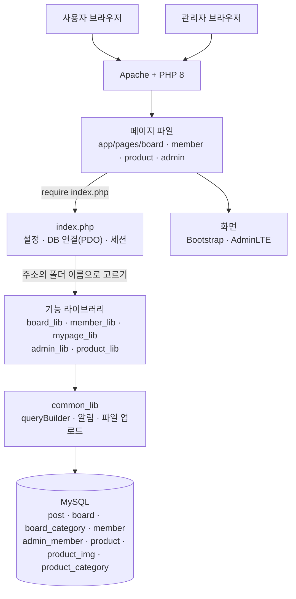
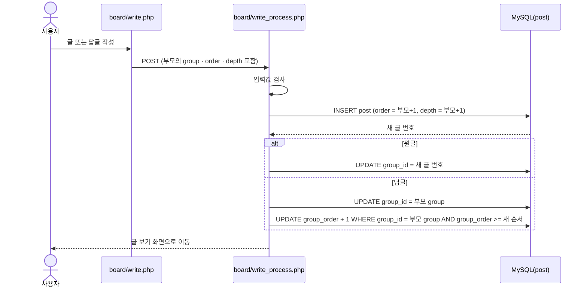
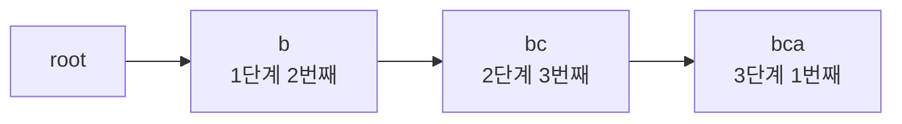

# 순서 갱신형 계층형 게시판 (Sequences Order Board)

답글이 원글 바로 아래에 트리 순서대로 달리는 **계층형 게시판**에서 시작해, 회원·관리자·상품·카테고리까지 넓힌 **PHP 웹서비스**입니다.
프레임워크 없이 PHP 8과 MySQL로 직접 구조를 잡았습니다.

| 항목 | 내용 |
|---|---|
| 기간 | 2022.10.25 ~ 2023.03.21 (설계 2022.09.20~, 커밋 105개) |
| 방식 | 개인 프로젝트 |
| 인원 | 1명 (설계·개발 단독) |
| 기술 | PHP 8.1, MySQL 8.0, Apache 2.4, PDO, Composer, Faker |
| 화면 | Bootstrap 3.3, jQuery 3.6, AdminLTE(관리자), Froala Editor, Dropzone.js, DataTables, jsTree |

## 개발 환경
<p>
   <a href="https://developer.apple.com/documentation/macos-release-notes/macos-13-release-notes"></a>
   <a href=""></a>
   <a href="https://brew.sh/index_ko"></a>
   <a href="https://git-scm.com"></a>
   <a href=""></a>
   <a href="https://httpd.apache.org/docs/2.4/ko/"></a>
   <a href="https://www.php.net/"></a>
   <a href="https://docs.phpmyadmin.net/en/latest/"></a>
   <a href=""></a>
   <a href="https://jquery.com/"></a>
   <a href=""></a>
   <a href=""></a>
   <a href=""></a>
   <a href=""></a>
   <a href=""></a>
   <a href=""></a>
   <a href=""></a>
   <a href=""></a>
   <a href=""></a>
   <a href=""></a>
</p>

## 기능 목록

### 1. 순서 갱신형 게시판 (Sequences Order Board)
- 계층형 게시판
   - 게시글 목록: 검색(제목·내용·작성자), 블록 페이징(한 페이지 10개, 한 블록 5페이지)
   - 게시글 작성: 위지윅 에디터 [Froala Editor](https://froala.com/wysiwyg-editor/) 사용
   - 게시글 보기, 조회수
   - 게시글 수정·삭제: 비회원은 비밀번호, 회원은 본인 확인 (삭제는 삭제 표시만 남김)
   - 게시글 답글: 원글 바로 아래에 트리 순서로 표시
   - 답글이 달린 원글은 수정·삭제 불가
- 계층형 구조를 익히기 위해, 처음 설계했던 댓글(별도 테이블) 방식을 답글(게시글 테이블 안) 방식으로 바꿨습니다.
- 화면 디자인은 [Bootstrap](http://bootstrapk.com/)을 사용했습니다.

### 2. 회원 관리 (Membership)
- 회원가입, 로그인·로그아웃
- 마이페이지: 비밀번호 확인 후 회원 정보 수정, 나의 게시글 목록·수정
- 로그인하지 않은 사용자의 마이페이지 접근 차단
- 회원가입·로그인 화면은 [무료 템플릿](https://inpa.tistory.com/entry/CSS-%F0%9F%92%8D-%EB%A1%9C%EA%B7%B8%EC%9D%B8-%ED%9A%8C%EC%9B%90%EA%B0%80%EC%9E%85-%ED%8E%98%EC%9D%B4%EC%A7%80-%EC%8A%A4%ED%83%80%EC%9D%BC-%F0%9F%96%8C%EF%B8%8F-%EB%AA%A8%EC%9D%8C)을 사용했습니다.

### 3. 관리자 페이지 (Admin)
- AdminLTE 기반 관리자 화면, 관리자 로그인
- 게시글 관리: 목록(DataTables), 보기, 수정, 삭제
- 회원 관리: 목록, 정보 보기·수정, 탈퇴
- 상품 관리: 등록·수정·삭제, 상품 이미지 업로드(Dropzone.js, 최대 5장·장당 5MB·jpg/png/gif)
- 카테고리 관리: jsTree로 4단계 카테고리 추가·삭제·이름 변경·끌어서 이동

### 4. 상품 (사용자 화면)
- 상품 목록, 상품 상세

### 5. 도구
- `generate_fake_data.php`: [Faker](https://fakerphp.org/)(한국어)로 게시글 더미 데이터 1만 개를 만듭니다.

## 구조

프레임워크 없이, 각 페이지가 맨 위에서 `index.php`를 불러 설정·DB 연결·세션을 준비하고, 주소에 맞는 기능 라이브러리를 불러 쓰는 구조입니다.



- `queryBuilder()`는 `select`, `join`, `where`, `orderby`, `limit` 같은 조건을 배열로 받아 SQL 문장을 만들어 주는 작은 함수입니다.
- 사용자 화면(`app/pages/board`, `member`, `product`)과 관리자 화면(`app/pages/admin`)의 경로를 나눴습니다.

## 답글 순서를 저장하는 방법

계층형 게시판을 저장하는 방식(순서 갱신형, 고정 위치형, 연결 리스트형, 프랙탈형)을 비교한 뒤,
게시판은 글을 쓰는 일보다 목록을 보는 일이 훨씬 많아서 **목록 출력이 가장 빠른 순서 갱신형**을 골랐습니다.

게시글마다 세 값을 둡니다.

| 칼럼 | 뜻 |
|---|---|
| `group_id` | 원글 묶음 번호. 원글은 자기 글 번호를 가지고, 답글은 부모의 값을 이어받음 |
| `group_order` | 묶음 안에서의 순서 |
| `group_depth` | 들여쓰기 깊이 (원글 0, 답글 1, 답글의 답글 2 …) |

목록은 `ORDER BY group_id DESC, group_order ASC` 한 번으로 최신 원글 순서와 답글 트리 순서를 함께 얻습니다.

```text
[원글]            group_id=10, order=0, depth=0
  └ RE: 답글 A    group_id=10, order=1, depth=1
      └ RE: 답글 B  group_id=10, order=2, depth=2
  └ RE: 답글 C    group_id=10, order=3, depth=1
```

### 답글 등록 흐름 (현재 코드)



## 4단계 카테고리

카테고리 코드를 **"부모 코드 + 순서 글자(a~z)"**로 만들어, 코드만 보고도 위치와 깊이를 알 수 있게 했습니다.



jsTree로 카테고리를 끌어서 옮기면, 옮긴 카테고리와 그 아래 카테고리의 코드·깊이를 새 위치 기준으로 다시 계산합니다.

## 폴더 구조

```
├── index.php                 모든 페이지가 맨 위에서 불러오는 시작 파일
├── generate_fake_data.php    게시글 더미 데이터 생성기
├── app/
│   ├── config/               config.php(주소·경로 상수), database.php(DB 연결)
│   ├── libraries/            기능별 라이브러리 (board, member, mypage, admin, product, common)
│   ├── pages/
│   │   ├── board/            게시판 목록·보기·쓰기·수정, 비밀번호 확인, 내 게시글
│   │   ├── member/           로그인·가입·마이페이지
│   │   ├── product/          상품 목록·상세
│   │   └── admin/            관리자 (AdminLTE 포함) - 게시글·회원·상품·카테고리
│   └── error/                404 화면
├── public/
│   ├── css/, js/             화면별 CSS·JS
│   └── vender/               Bootstrap, Froala Editor, Dropzone
└── vendor/                   Composer 패키지 (Faker)
```

## 실행 방법

1. Apache 가상 호스트를 `http://example01.com`으로 잡고, 문서 루트를 이 저장소 폴더로 지정합니다.
2. `app/config/config.php`의 `DOMAIN`, `PATH_ROOT`, `PATH_STORAGE`를 내 환경에 맞게 바꿉니다.
3. `app/config/database.php`에 MySQL 접속 정보를 넣습니다. (테이블을 만드는 SQL은 저장소에 없습니다.)
4. 더미 데이터가 필요하면 `composer install` 후 `php generate_fake_data.php`를 실행합니다.
5. 브라우저에서 `/app/pages/board/list.php`로 들어갑니다.

## 한계와 남은 과제

포트폴리오를 정리하며 코드를 다시 검증했고, 아래 문제를 찾았습니다. 저장소 코드는 아직 고치지 않았습니다.

### 1. 답글 순서가 틀어지는 버그

새 답글을 먼저 넣고 나서 "순서가 새 답글 이상인 글은 모두 +1"을 하는데, 이때 **방금 넣은 답글 자신도 함께 밀립니다.** 그래서 순서 번호가 건너뛰거나 겹칩니다.

| 작성 순서 | 무엇에 단 답글인지 | 저장된 순서 |
|---|---|---|
| 글1 | 원글 | 4 |
| 글2 | 원글 | 2 |
| 글3 | 글2 | 4 (글1과 겹침) |
| 글4 | 글3 | 6 |

글4는 글3 바로 아래에 와야 하지만, 목록에서는 글1 아래에 보입니다.
먼저 부모보다 뒤에 있는 글을 밀고, 그다음 부모 바로 아래에 새 답글을 넣으면 해결됩니다. 두 작업은 하나의 트랜잭션으로 묶습니다.

```sql
-- 부모(:g, :o, :d)는 화면에서 받은 값이 아니라 DB에서 부모 글 번호로 다시 읽는다
UPDATE post SET group_order = group_order + 1 WHERE group_id = :g AND group_order > :o;
INSERT INTO post (..., group_id, group_order, group_depth) VALUES (..., :g, :o + 1, :d + 1);
```

### 2. 보안

- **SQL 끼워넣기(SQL Injection):** 로그인 아이디(회원·관리자), 게시글 번호, 답글 그룹 값을 SQL 문자열에 그대로 붙이는 곳이 있습니다. 모든 쿼리를 PDO 바인딩(`?`)으로 바꿔야 합니다.
- **화면 스크립트 실행(저장형 XSS):** 저장할 때 바꾼 HTML을 보여 줄 때 되돌려 그대로 출력합니다. 허용할 태그만 남기는 필터(예: HTML Purifier)가 필요합니다.
- **비밀번호 저장:** `md5`로 저장하고 세션에 비밀번호 해시를 넣어 둡니다. `password_hash`·`password_verify`로 바꾸고 세션에는 넣지 않아야 합니다.
- **답글 위치를 화면 값으로 정함:** 순서·깊이를 화면의 숨은 칸에서 받아 씁니다. 부모 글 번호만 받고 나머지는 DB에서 읽어야 합니다.
- **업로드 형식 검사:** 이미지 형식을 브라우저가 보낸 MIME 값으로만 확인합니다. 파일 내용으로 다시 확인해야 합니다.

### 3. 마무리하지 못한 부분

- 카테고리를 이미 다른 카테고리가 있는 자리로 옮기는 경우는 처리하지 못합니다.
- 상품 수정 화면의 업로드 검사(5장·5MB·형식)는 테스트를 마치지 못했습니다.
- 여러 번의 UPDATE를 트랜잭션 없이 실행해, 중간에 실패하면 데이터가 어긋날 수 있습니다.
- 답글이 있는지는 원글 묶음(`group_id`) 기준으로만 확인해, 답글에 달린 답글이 있어도 그 답글은 수정·삭제할 수 있습니다.
